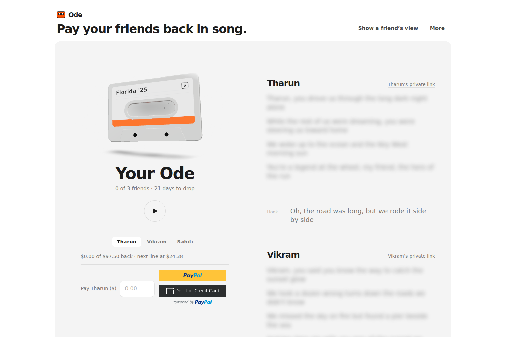
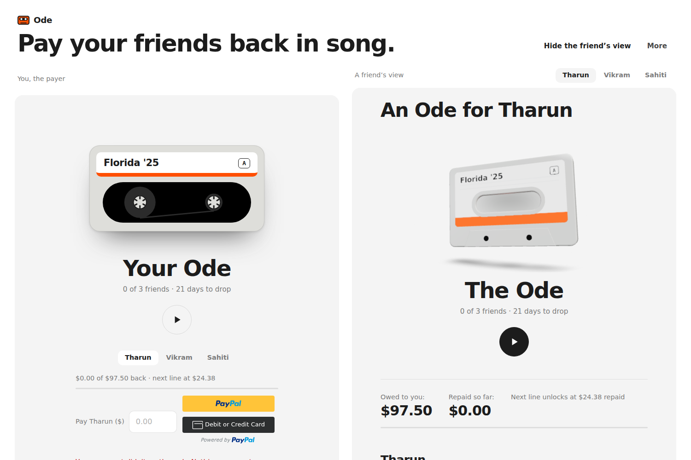
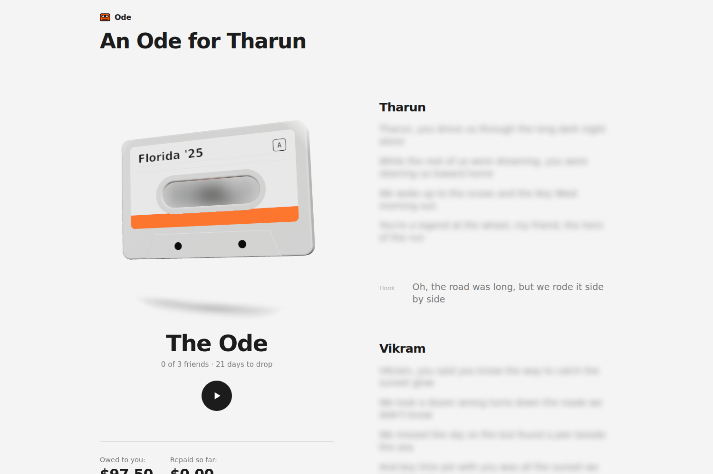
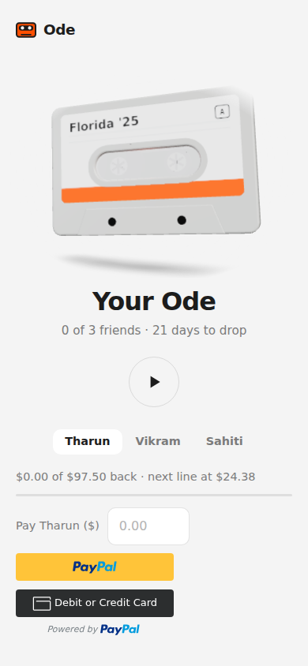
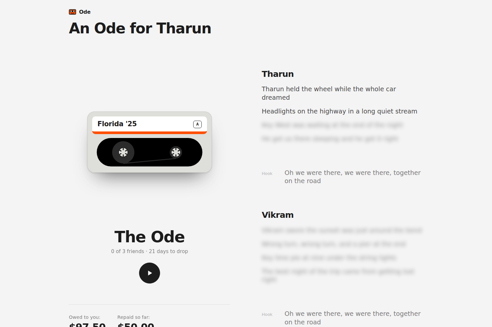
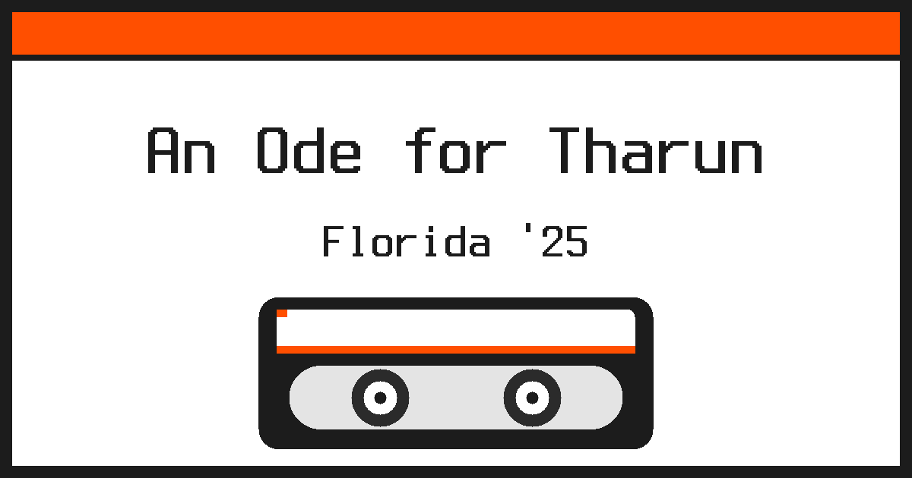
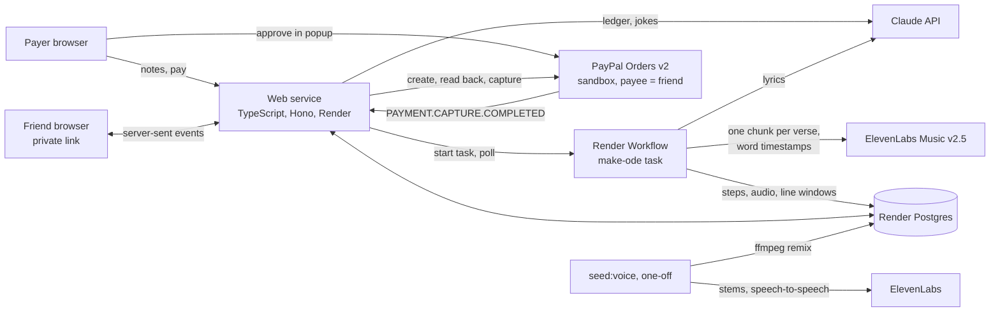

# Ode

**A song about your trip, where each friend's lines unlock as you pay them back.**

Ode turns a trip's unpaid costs into a song. You paste your trip notes, Claude works out who covered what and writes a verse for each friend, ElevenLabs Music composes it, and every payment you send a friend through PayPal makes the next of their four lines clear. The last payment drops the chorus.

[Live demo](https://ode-nluc.onrender.com) · Built for the PayPal AI Hackathon 2026 · [MIT licence](LICENSE)



| Pay on the left, the friend sees it on the right | A friend's private link, lines still locked | On a phone |
|---|---|---|
|  |  |  |

More in [`docs/screenshots/`](docs/screenshots/). Files with `FAKE` in the name come from `npm run dev:fake` (a fake PayPal, so no real payment was made); the rest are the live site.

| After a $50 payment (fake PayPal) | The share card (fake) |
|---|---|
|  |  |

## Why

Florida, 2025: friends covered about $257.50 for me. A year later nobody had asked, and I still hadn't paid. In a 2023 UK survey of 2,000 adults, 46% found asking for money back too awkward. Between close friends nobody sends a reminder, and when money is tight a small transfer feels too small to send. Ode makes the payback worth sending, and turns every small payment into progress a friend can hear.

## How it works

1. Paste your trip notes. Claude rebuilds the ledger (friend, amount owed) and finds one inside joke per friend. Group costs you covered are split evenly. You confirm or edit the ledger.
2. Claude writes four lines per friend, a hook between verses and a final chorus. The lines sing memories, never amounts or brand names.
3. You pick a release date. ElevenLabs Music v2.5 composes the song with one chunk per verse ([ADR 0001](docs/adr/0001-one-chunk-per-verse.md)), and word timestamps give every line its window. This runs as a Render Workflow task.
4. Each 25% you repay a friend, through a PayPal order paid to that friend, unlocks their next line. Locked lines are blurred on the page and muffled in the audio. The chorus drops when every friend is fully repaid.
5. Each friend gets a private link that plays the whole Ode and shows only their own amounts, updating live when a payment lands. A friend can share their unlocked lines as "An Ode for <name>".

The vocabulary (Ode, Cassette, Ledger, Unlock and so on) is in [`GLOSSARY.md`](GLOSSARY.md).

## How PayPal and AI are used

**PayPal (Orders v2, sandbox)**
- Each payment is an Orders v2 order whose `purchase_units[].payee` is that friend's sandbox account, created by the server and approved in the PayPal JS SDK popup.
- Lines unlock on a captured payment. Whichever arrives first, the capture response or the verified `PAYMENT.CAPTURE.COMPLETED` webhook, unlocks them, keyed on the capture ID, so a duplicate unlocks nothing twice.
- Amounts repaid are counted before fees and never exceed the amount owed.

**AI**
- **Claude** (`claude-opus-5-5`) turns messy trip notes into the ledger and one inside joke per friend, then writes the lyrics within the music model's limits.
- **ElevenLabs Music v2.5** composes the song, one chunk per verse. Word timestamps are aligned to the lyrics to give each line its window (equal quarters if alignment fails).
- **ElevenLabs stem separation, speech-to-speech and a cloned voice** are used only for the Seeded Ode, once, in a one-off command that puts the payer's cloned voice on the vocals ([ADR 0002](docs/adr/0002-cloned-voice-only-on-seeded-ode.md)). Every other Ode keeps the music model's own vocals.

## Architecture



The web service holds the API, the React client and the friend event streams. The Workflow task writes its steps to Postgres as it goes, which is what the status steps on the page show ([ADR 0003](docs/adr/0003-the-workflow-reports-progress-through-postgres.md)). Open friend views read their view from Postgres every 250 ms inside a server-sent event stream, so any process can serve an unlock ([ADR 0004](docs/adr/0004-friend-views-follow-changes-by-polling.md)).

## Testing the demo

The live site works without an account. You land on a split screen with your own unpaid copy of the Seeded Ode ("Florida '25"): pay on the left, watch a friend's view on the right.

To pay a friend, use the PayPal **sandbox test buyer** in the PayPal popup. It is a sandbox account with fake money; no real card or money is involved.

- Email: `<buyer email>`
- Password: `<buyer password>`

(The real values are in the Devpost submission's testing instructions.)

Things to know:
- Pay Tharun $25 to unlock his first line (each line is 25% of what is owed). In the sandbox a $1 payment is charged $0.52 in fees.
- **More** (top right) holds **Make my own Ode** and **Reset demo**. Reset demo clears only your browser's payments on the Seeded Ode.
- **Make my own Ode** builds a new Ode from your own notes (1 to 3 friends, paid through the sandbox friend accounts). It spends the maker's music credits, so at most 5 Own Odes start per day across all visitors; after that you stay on the Seeded Ode.
- Payments on the Seeded Ode are per browser. Your friend links are private to you.

## Run it yourself

Needs Node 24 or newer. A fresh clone runs with no keys and no database:

```sh
git clone https://github.com/sivaratrisrinivas/ode.git
cd ode
npm ci
npm run dev:fake        # builds the page, serves the real API over in-process Postgres with fake Claude and music
```

Open http://localhost:3000 (`PORT` changes it). The fakes are in `src/testing/`; the PayPal step shows a plain "Pay <friend>" button against a fake PayPal, and the audio is placeholder bytes, so nothing is audible. State lives in memory and ends with the process. More about the page flow and the fakes: [`docs/agents/run.md`](docs/agents/run.md).

### With real keys

Needs a Postgres database and the accounts below.

```sh
cp .env.example .env     # then fill it in, see the table
npm ci
npm run build            # builds the React client into dist/
npm start                # migrates the database on startup, then serves on PORT
npm run seed:ode         # once: builds the Seeded Ode from seed/notes.txt (about 1,300 music credits, measured in `notes/reliability-2026-11-12.md`)
```

`npm run dev:server` restarts on file changes and `npm run dev:client` runs Vite with `/api` proxied to the server. A friend's link and the cassette work as soon as an Ode exists.

| Variable | Where it comes from |
|---|---|
| `DATABASE_URL` | Local Postgres, or Render Postgres (render.yaml sets it). For an external connection add `?sslmode=require`. |
| `PORT` | Optional; default 3000. |
| `ANTHROPIC_API_KEY` | console.anthropic.com |
| `ELEVENLABS_API_KEY` | elevenlabs.io (Music needs a paid plan). On Render only the Workflow task needs it. |
| `PAYPAL_CLIENT_ID`, `PAYPAL_CLIENT_SECRET` | developer.paypal.com, Apps & Credentials, Sandbox app. |
| `PAYPAL_ENV` | `sandbox` (the only environment this has been run in). |
| `PAYPAL_WEBHOOK_ID` | The ID of a sandbox webhook that posts to `https://<your-host>/api/payments/webhook` and is subscribed to `PAYMENT.CAPTURE.COMPLETED`. `node --env-file=.env scripts/webhook-check.ts` checks it. |
| `FRIEND_PAYPAL_ACCOUNTS` | `Name=email` pairs: the sandbox Personal accounts that receive each friend's payments, in the ledger's friend order. Create them in the PayPal sandbox. |
| `RENDER_API_KEY`, `ODE_WORKFLOW_SLUG` | Render account settings, API Keys; the slug of your Workflow. Leave both empty off Render to make the Ode inside the web service. |
| `ELEVENLABS_VOICE_ID` | Optional; your own cloned voice, used only by `npm run seed:voice`. |
| `VOICE_LABEL` | Optional; `like` changes the Seeded Ode's label to "a voice like mine". |

Needs `ffmpeg` on the PATH only for `npm run seed:voice`.

### Deploy on Render

`render.yaml` defines the web service, the Postgres database and the Workflow. Push to a repository, then in Render choose New, Blueprint. Set the secrets Render asks for, and set `RENDER_API_KEY` by hand.

## Render Workflow

"Make the Ode" runs the song pipeline (lyrics, compose, line windows, store) as one task, `make-ode`, of a [Render Workflow](https://render.com/docs/workflows). The web service records the run in Postgres, starts the task with the Render SDK, and polls it. The task writes each step (writing, composing, finding lines) to Postgres as it goes, and that is what the status steps show; Render's own run status only tells the web service whether the run is still alive, so a run that dies shows as failed with a retry instead of spinning forever.

- Web service: `src/server/` (`ode-service.ts` starts and polls, `render-workflow.ts` talks to Render).
- Workflow task: `src/workflow/` (`index.ts` registers the task and is the Workflow's start command). It reads `DATABASE_URL`, `ANTHROPIC_API_KEY` and `ELEVENLABS_API_KEY` from its own environment when a run starts, never when the file loads.
- Render runs the task once and never retries it, because a retry would compose, and pay for, the song again. The payer's "Try again" is the retry.

Both services are in `render.yaml`. Two things are not in the file and are set by hand:

- `RENDER_API_KEY` on the web service: an API key from Render account settings.
- The `sync: false` secrets (`ANTHROPIC_API_KEY` on both services, `ELEVENLABS_API_KEY` on the workflow): Render asks for them when the Blueprint is created or synced; if it does not, set them in the dashboard.

Without `RENDER_API_KEY` and `ODE_WORKFLOW_SLUG`, and off Render, the web service runs the same job inside its own process so that local development needs no Render account (it then also needs `ELEVENLABS_API_KEY`). On Render, or with only one of the two set, startup stops with a message naming the missing variable, never a quiet fallback to the web service process. A deploy that cannot start the Workflow therefore fails, and Render keeps serving the previous deploy, so set `RENDER_API_KEY` before merging.

## The Seeded Ode in the payer's voice

Only the Seeded Ode is sung in the payer's cloned voice ([ADR 0002](docs/adr/0002-cloned-voice-only-on-seeded-ode.md)); every other Ode keeps Eleven Music's vocals. A one-off command converts it: ElevenLabs stem separation (`two_stems_v1`) into vocals and music, speech-to-speech (`eleven_multilingual_sts_v2`) of the vocals into the voice in `ELEVENLABS_VOICE_ID`, and an ffmpeg remix at 128 kbps, which replaces the stored audio. The Ode's line windows are not touched, so the command refuses to store a remix whose length is more than 250 ms from the original's (`MAX_LENGTH_CHANGE_MS` in `src/server/voice-conversion.ts`). The cassette page then says "in my voice" under the Seeded Ode's title; if the clone is not recognised, change that one string in `src/server/voice.ts` to "a voice like mine".

Run it once, from a machine with Node 24 and `ffmpeg`, after the Seeded Ode is made on the hosted site (steps in [`docs/agents/seed-voice.md`](docs/agents/seed-voice.md)):

```sh
npm run seed:voice
```

## Test

```sh
npm test            # API tests: in-process Postgres, fakes for Claude, Eleven Music, PayPal, the clock and the Workflow
npm run check       # tsc, every type assertion has a SAFETY comment, and the import check (scripts/check-imports.ts)
```

Tests drive the HTTP API only (`test/harness.ts`). The fake Workflow runs the task's job in the test process with its own database stores, as a separate process would. `test/render-workflow.test.ts` and `test/workflow-config.test.ts` cover the two pieces that only touch Render's SDK and the environment. `npm test` takes 2 to 7 minutes.

## Tools used

- **PayPal**: Orders v2 and the JS SDK (sandbox), capture webhooks.
- **Anthropic**: Claude API (`claude-opus-5-5`).
- **ElevenLabs**: Music v2.5, stem separation, speech-to-speech, instant voice cloning.
- **Render**: web service, Postgres, Workflows.
- **Code**: TypeScript, Node 24, Hono, React, Vite, three.js (the 3D cassette, with a flat fallback), Server-Sent Events, PostgreSQL, ffmpeg, Vitest.

## Limitations

- **Sandbox only.** In production, PayPal charges the receiver fees on a payment like this (in the sandbox a $1 payment is charged $0.52), so a launch needs a fee-free friends-and-family rail.
- **Voice conversion runs only on the Seeded Ode**, with the payer's own voice. A launch would need it per Ode, plus voice verification.
- **No sung replies**: inpainting is enterprise-only on the music API. Notes are text, not receipt photos.
- Own Odes are limited to 1 to 3 friends and 5 a day across all visitors, to protect the music credits.

## License

[MIT](LICENSE)
