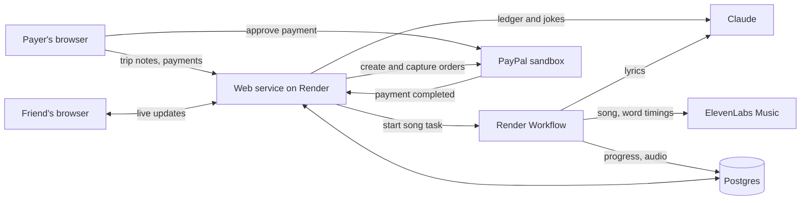

# Ode

A song about your trip, where each friend's lines unlock as you pay them back.

Try it: https://ode-nluc.onrender.com

## What it is

You paste in your trip notes. Ode works out who paid for what, writes a song about the trip with a few lines for each friend, and locks those lines. Every time you pay a friend back through PayPal, the next line of their verse unlocks. When the last friend is fully paid, the chorus plays.

Each friend gets their own private link. They hear the whole song, see only what you owe them, and watch their lines unlock as the money arrives.

## Why I built it

Florida, 2025. My friends covered about $257.50 for me. A year later nobody had asked, and I still hadn't paid. In a 2023 UK survey of 2,000 adults, 46% said asking friends for money back is too awkward. So between close friends nobody sends a reminder, and when money is tight a small payment feels too small to send.

Ode makes paying back worth sending. Every small payment becomes something a friend can hear.

## How it works

1. **Notes to ledger.** You paste your notes. Claude (Anthropic's AI) lists what each friend is owed and finds one inside joke per friend. You check and fix the numbers.
2. **Ledger to lyrics.** Claude writes four lines per friend, plus a hook and a chorus. The lines are about memories, never amounts.
3. **Lyrics to song.** ElevenLabs Music turns the lyrics into one song. The work runs as a Render Workflow task, so the page can show its progress. Word timings from ElevenLabs tell the page when each line is sung.
4. **Paying unlocks lines.** Each payment is a PayPal order (sandbox, so no real money) paid straight to that friend. Every 25% you repay unlocks the next line. Locked lines are blurred on the screen and muffled in the audio. The chorus drops when everyone is paid in full.
5. **Friend links.** A friend's page updates live when a payment lands. They can share their unlocked lines as "An Ode for their name".

The demo Ode on the live site is sung in my own voice, using a one-off script that swaps the singer for my cloned voice. Odes that other people make keep the music model's own voice.

## Getting started

You need Node 24 or newer.

**Try it with no keys.** This uses stand-ins for Claude, the music model and PayPal, so nothing is spent and no sound plays:

```sh
git clone https://github.com/sivaratrisrinivas/ode.git
cd ode
npm ci
npm run dev:fake
```

Then open http://localhost:3000.

**Run it for real.** You need a Postgres database and these accounts. Copy `.env.example` to `.env` and fill it in:

- `DATABASE_URL`: your Postgres database
- `ANTHROPIC_API_KEY`: from console.anthropic.com
- `ELEVENLABS_API_KEY`: from elevenlabs.io (music needs a paid plan)
- `PAYPAL_CLIENT_ID` and `PAYPAL_CLIENT_SECRET`: a PayPal sandbox app
- `PAYPAL_WEBHOOK_ID`: a sandbox webhook that posts to `https://your-site/api/payments/webhook` for `PAYMENT.CAPTURE.COMPLETED`
- `FRIEND_PAYPAL_ACCOUNTS`: the sandbox accounts that receive each friend's money, written as `Name=email` pairs

```sh
npm run build
npm start
npm run seed:ode    # once, to build the demo Ode
```

To run it on Render, `render.yaml` sets up the website, the database and the workflow.

## Architecture



The web service serves the page and the API. It hands the slow song-making to the Render Workflow, which reports its progress through the database. Payments go through PayPal, and a confirmed payment unlocks lines and updates the friend's open page.
