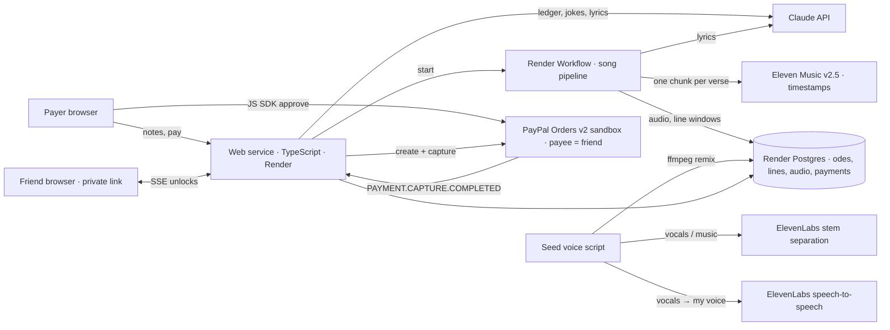

# Ode

**A song about your trip, in your voice, where each friend's lines unlock as you pay them back.**

[Demo video](YOUTUBE_URL) · [Live app](RENDER_URL) · Built for the PayPal AI Hackathon 2026


## Why
Florida, 2025. My school friends covered about $[total] for me. A year later nobody has asked, and I still haven't paid. 46% of people find asking for money back too awkward ([Starling Bank, n=2,000](https://www.starlingbank.com/news/one-third-of-uk-adults-owed-money-by-friends-and-family)). Between close friends nobody sends a reminder, and when money is tight a small transfer feels too small to send. Ode turns the payback into something worth sending, and turns every small payment into progress your friends can hear.

## How it works
1. Paste your trip notes. Claude rebuilds the ledger (friend, amount owed) and finds one inside joke per friend. Group costs you covered are split evenly.
2. Claude writes 4 lines per friend, plus a hook and a chorus. The lines sing memories, never amounts, brand names or song titles.
3. Eleven Music v2.5 composes the song with **one chunk per verse**, and word timestamps give every line its window. This runs as a Render Workflow task. The seeded demo Ode was also split and converted into my cloned voice by a one-off script.
4. Every 25% you repay a friend through PayPal unlocks their next line. The last payment drops the chorus. The release date can't be moved; miss it and the Ode shows as delayed.
5. Each friend's private view plays the whole Ode with only their own amounts, and they can share their unlocked lines as "An Ode for [name]".



## Try it (judges)
- Live app: RENDER_URL. You land on a split screen with your own unpaid copy of the seeded "Florida '25" Ode: pay on the left, watch a friend's view on the right.
- **PayPal sandbox test buyer:** `BUYER_EMAIL` / `BUYER_PASSWORD`. Use it in the PayPal popup.
- You can make a new Ode from your own trip notes (1–3 friends, paid through the 3 sandbox friend accounts). Up to 5 new Odes a day across all visitors; after that the seeded Ode is shown.

## Run locally
```bash
git clone REPO_URL && cd ode
cp .env.example .env   # fill in the values below
npm install
npm run db:migrate
npm run seed           # seeded Florida trip + 3 sandbox friends
npm run seed:voice     # optional: convert the seeded Ode into ELEVENLABS_VOICE_ID
npm run dev
```

| Env var | Where to get it |
|---|---|
| `ANTHROPIC_API_KEY` | console.anthropic.com |
| `ELEVENLABS_API_KEY` | elevenlabs.io (Music needs a paid plan) |
| `ELEVENLABS_VOICE_ID` | your Instant Voice Clone (optional; used only by `seed:voice`) |
| `PAYPAL_CLIENT_ID`, `PAYPAL_CLIENT_SECRET` | developer.paypal.com → Sandbox app |
| `PAYPAL_WEBHOOK_ID` | the sandbox webhook subscribed to `PAYMENT.CAPTURE.COMPLETED` |
| `DATABASE_URL` | local Postgres or Render Postgres |

**Sandbox accounts:** create 1 personal account for the payer and 3 friend accounts, then put the friends' emails in `seed/trip.json`. Requires ffmpeg on the PATH.

## Deploy on Render
`render.yaml` defines the web service, Postgres and the Workflow. Push to GitHub, then go to Render → New → Blueprint.

## Limitations
- Sandbox only. In production, Checkout charges the receiver merchant fees, so a launch needs a fee-free friends-and-family rail.
- Voice conversion runs only on the seeded Ode, with my own voice; a launch needs it per Ode plus voice verification. Only the payer can lock lines.
- No sung replies (Eleven inpainting is enterprise-only). Notes are text, not receipt photos.
- Single hard-coded user; no auth.

## License
MIT
